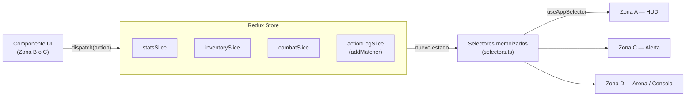

# ⚒️ HeroForge RPG — Arquitectura de Estado Visual con Redux Toolkit

Mini-juego en **React Native (Expo) + TypeScript + Redux Toolkit** donde cada acción despachada en una zona de la pantalla provoca reacciones visuales inmediatas en las otras zonas, **sin pasar una sola prop entre ellas**.

> Taller Práctico — Desarrollo Móvil (individual)

---

## 🎨 Dirección de diseño — "hoja de personaje"

La interfaz imita una **hoja de personaje de rol de mesa** sobre una mesa de madera, en lugar del típico dashboard oscuro con neón:

- **Papel y tinta:** fondo de papel envejecido, tinta sepia, sombras "duras" sin desenfoque (papel apilado) y cinta adhesiva sujetando cada sección.
- **Tipografía con oficio:** _IM Fell English_ (imprenta antigua) para títulos y números, _Crimson Pro_ para texto, _Caveat_ para las notas a lápiz en los márgenes y _Courier Prime_ (máquina de escribir) para la bitácora de Redux.
- **Imperfección intencional:** cada sección y cada objeto tiene una inclinación leve y **fija** (no aleatoria, para que el layout sea estable entre renders).
- **Metáforas del juego de mesa:** atributos como casillas con puntitos que se rellenan, sello de goma "EQUIPADO", sello rojo de "SOBRECARGA" sobre el retrato, botones que se hunden como un sello al presionarlos, y la consola de acciones como un cuaderno rayado con margen rojo.
- Todos los colores, fuentes y sombras salen de `src/theme/index.ts`.

**Separación de responsabilidades:** el rediseño completo no tocó ni un reducer. El único cambio en el store fue _quitarle_ presentación: el selector de clase ahora devuelve solo `{ id, label }`, y el color y el dibujo de cada clase los decide la UI (`classInk` en el tema, `CLASS_PORTRAIT` en el avatar).

## 🚀 Cómo ejecutarlo

```bash
npm install
npm start          # abre Expo; escanea el QR con Expo Go o pulsa "a" (Android) / "i" (iOS) / "w" (web)
```

| Script              | Qué hace                                        |
| ------------------- | ----------------------------------------------- |
| `npm start`         | Servidor de desarrollo de Expo                  |
| `npm run typecheck` | Verificación de tipos con TypeScript (`strict`) |
| `npm run lint`      | ESLint (config oficial de Expo + Prettier)      |
| `npm test`          | 28 pruebas unitarias y de integración con Jest  |
| `npm run validate`  | Las tres anteriores en cadena                   |
| `npm run format`    | Formatea todo con Prettier                      |

---

## 🗺️ Las 4 zonas visuales

| Zona                         | Componente               | Rol frente al Store                                                                                                                        |
| ---------------------------- | ------------------------ | ------------------------------------------------------------------------------------------------------------------------------------------ |
| **A** · I. El Héroe          | `<HeroAvatarHUD />`      | **Solo lee** selectores derivados: avatar (aura, clase, expresión, arma), barras de HP / Maná / Peso, poder y velocidad. No tiene botones. |
| **B** · II. Entrenamiento    | `<StatsControlPanel />`  | **Despacha** `incrementStat`, `decrementStat`, `applyBuildPreset`, `resetStats`.                                                           |
| **C** · III. La Mochila      | `<ArmoryGrid />`         | **Despacha** `toggleEquipItem`, `clearEquipment`. Muestra la alerta de **¡SOBRECARGADO!**                                                  |
| **D** · IV. Arena & Bitácora | `<ReduxLiveInspector />` | Arena contra el jefe (thunk `attackBoss`, `healHero`) + **consola en vivo** con las últimas 5 acciones (`type → payload`).                 |

Las zonas son hermanas dentro de `GameScreen` y **no reciben props**: cero _prop drilling_.

---

## 🔁 Flujo unidireccional



**UI → `dispatch(action)` → Reducer (Immer) → nuevo State → Selector → re-render** solo de los componentes cuyo dato cambió.

---

## 🏗️ Estructura del proyecto

```
src/
├── components/            # SOLO UI (sin lógica de negocio)
│   ├── HeroAvatarHUD/     # Zona A (HeroAvatar animado + HUD)
│   ├── StatsControlPanel/ # Zona B (StatRow por atributo)
│   ├── ArmoryGrid/        # Zona C (ItemCard memoizada)
│   ├── ReduxLiveInspector/# Zona D (BossArena + ActionConsole)
│   └── ui/                # Primitivas reutilizables: ProgressBar, GameButton, ZoneCard
├── screens/GameScreen.tsx # Compone las 4 zonas
├── store/                 # SOLO estado
│   ├── index.ts           # configureStore + setupStore() + tipos RootState/AppDispatch
│   ├── hooks.ts           # useAppDispatch / useAppSelector tipados
│   ├── selectors.ts       # TODO el estado derivado (createSelector)
│   ├── slices/            # statsSlice, inventorySlice, combatSlice, actionLogSlice
│   ├── thunks/            # attackBoss (aleatoriedad fuera de los reducers)
│   ├── utils/             # describePayload (formato legible para la consola)
│   └── __tests__/         # Pruebas de reducers, selectores y thunk
├── constants/gameRules.ts # Reglas y números del juego (sin "números mágicos")
├── data/itemsCatalog.ts   # Catálogo estático de 8 ítems
├── theme/                 # Tokens de diseño (colores, espaciado, tipografía)
└── types/game.ts          # Tipos del dominio
```

---

## 🧠 Decisiones de arquitectura (buenas prácticas aplicadas)

### Store y slices

- **3 slices pedidos + 1 extra** (`combatSlice`): el HP del jefe no es un atributo del héroe, así que vive en su propio slice (responsabilidad única).
- `PayloadAction<'str' | 'agi' | 'int'>`, `PayloadAction<BuildPreset>`, etc.: los payloads están tipados, un `incrementStat('fuerza')` no compila.
- **Reducers puros** con guardas: no se puede gastar puntos que no hay, bajar de 1, tener HP negativo ni equipar un ID inexistente.
- `setupStore(preloadedState)` es una **fábrica**: la app usa una instancia y cada prueba crea la suya aislada.
- Hooks tipados con `useDispatch.withTypes<AppDispatch>()` / `useSelector.withTypes<RootState>()` (API actual de react-redux 9).

### Regla de Oro — estado derivado

Ningún valor calculado se guarda en el estado. Los slices guardan solo **datos fuente** (atributos base, IDs equipados, daño recibido por el jefe); todo lo demás sale de `selectors.ts`:

| Selector                                        | Cálculo                                                                                                             |
| ----------------------------------------------- | ------------------------------------------------------------------------------------------------------------------- |
| `selectTotalStats`                              | atributos base + bonos de ítems equipados (cruza `stats` + `inventory`)                                             |
| `selectTotalWeight` / `selectMaxWeightCapacity` | Σ pesos / `10 + STR total × 2`                                                                                      |
| `selectIsOverencumbered`                        | peso > capacidad                                                                                                    |
| `selectCombatPower`                             | `STR×3 + AGI×2 + INT×3`, −30 % si hay sobrecarga                                                                    |
| `selectSpeed`                                   | AGI total, −50 % si hay sobrecarga                                                                                  |
| `selectHeroVisualClass`                         | Aldeano / Guerrero Berserker / Archimago / Asesino Sombrío / Tanque Pesado según la estadística dominante y el peso |
| `selectHeroCondition`                           | sano / herido / crítico / derrotado según el HP                                                                     |
| `selectBossMaxHp`, `selectBossHp`               | derivados del nivel del jefe y el daño acumulado                                                                    |

Se usan **selectores atómicos** de entrada (`selectBaseStr`, `selectBaseAgi`…) para que recibir daño no invalide la memoización de los atributos (hay una prueba que lo verifica).

### `actionLogSlice` — el monitor que se alimenta solo

Usa `extraReducers` + `builder.addMatcher` para capturar toda acción de `stats/`, `inventory/` y `combat/`. Ningún componente tiene que "avisarle" al log. Cada entrada usa un número secuencial (no `Date.now()`) para mantener el reducer puro, y se guardan solo las últimas 5.

### Lógica asíncrona / aleatoria

El combate tiene variación aleatoria de ±20 %. Esa aleatoriedad vive en el **thunk** `attackBoss`, nunca en un reducer. El generador aleatorio es inyectable, así las pruebas son deterministas.

### UI

- Componentes de UI **sin lógica de negocio**: solo leen selectores y despachan acciones.
- `React.memo` + `useCallback` en tarjetas y filas para evitar renders innecesarios; `StatRow` se suscribe solo a su propio atributo.
- Animaciones con `Animated` (barras, "pop" del avatar al cambiar de clase, sacudida al recibir daño, entrada de líneas en la bitácora).
- Accesibilidad: `accessibilityRole`, `accessibilityLabel`, `accessibilityState` y `accessibilityValue` en controles y barras.
- Tokens de tema centralizados; nada de colores escritos a mano en los componentes.

---

## 🧪 Pruebas

```
src/store/__tests__/statsSlice.test.ts       → reducers, límites e inmutabilidad
src/store/__tests__/inventoryAndLog.test.ts  → equipamiento y registro automático (addMatcher)
src/store/__tests__/selectors.test.ts        → fórmulas, sobrecarga, clases y memoización
src/store/__tests__/combatThunks.test.ts     → turno de combate determinista
src/screens/__tests__/GameScreen.test.tsx    → "efecto dominó" entre zonas renderizadas
```

---

## 🎮 Demostraciones rápidas para el video

1. **Preset → todo cambia:** pulsa _Mago_: puntos a 0, barras de nivel, retrato con tinta azul "Archimago", maná sube, poder recalculado y `[stats/applyBuildPreset] → "MAGE"` en la bitácora.
2. **Sobrecarga:** sin preset, equipa _Escudo de Titanio_ + _Espada de Fuego_ (barra amarilla) y luego _Armadura Maldita_ → barra roja, sello de SOBRECARGA sobre el retrato, alerta en la armería, velocidad −50 % y poder −30 %.
3. **Tanque Pesado:** pulsa _Guerrero_ y equipa la _Armadura Maldita_ → la clase pasa de Berserker a Tanque Pesado sin tocar el panel de atributos.
4. **Combate:** ataca varias veces: el avatar se sacude, cambia la expresión (😄 → 😣 → 😵 → 💀) y el botón se deshabilita al caer. _Curar_ lo restaura.
